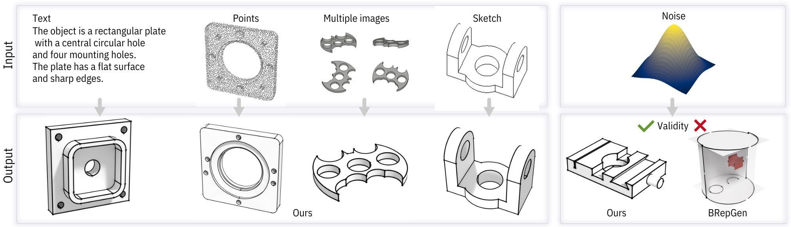

# HoLa-Brep: Holistic Latent Representation for B-rep Generation

[](https://arxiv_url)

*[Author1](https://Author1), [Author2](https://Author2), [Author3](https://Author3), ...*

<p align="center">
    
</p>

> This repository is for the HoLa-Brep project. Given a B-rep model which consists of surfaces, (half-) curves and vertices, we design a novel holistic latent representation (HL-Rep) to encode both the continuous geometric properties over all primitives and their discrete topological relationships into one holistic latent space. Compared with existing methods, primitives in the holistic latent space are intrinsically consistent, which enables a more accurate and expressive B-rep generation.

## About HoLa-Brep
W.I.P


## Checkpoints
Pre-trained checkpoints are available for **[download](https://somewhere)**. The file `ckpt.zip` should contain the following checkpoints:

| Checkpoint                            | Description                                                   |
| ------------------------------------- | ------------------------------------------------------------- |
| AE_ABC_1100k.ckpt                     | Autoencoder pre-trained on ABC dataset                        |
| AE_deepcad_1100k.ckpt                 | Autoencoder pre-trained on deepcad dataset                    |
| Diffusion_uncond_1100k.ckpt           | Pre-trained unconditional latent diffusion model              |
| Diffusion_mvr_sq30_800k.ckpt          | Pre-trained multi-image-conditioned latent diffusion model    |
| Diffusion_pc_sq30_1600k.ckpt          | Pre-trained point-conditioned latent diffusion model          |
| Diffusion_pc_sq30_noisy_2300k.ckpt    | ****************************WIP****************************   |
| Diffusion_sketch_sq30_1500k.ckpt      | Pre-trained sketch-conditioned latent diffusion model         |
| Diffusion_svr_sq30_1500k.ckpt         | Pre-trained single-image-conditioned latent diffusion model   |
| Diffusion_txt_sq30_1000k.ckpt         | Pre-trained text-conditioned latent diffusion model           |


## Environment Preparation
### Run locally 
We built the project based on **Linux** environment.

1. Install Linux dependencies:
```
apt update
apt install libgl-dev
apt install freeglut3 freeglut3-dev libosmesa6-dev libglu1-mesa-dev libglu1-mesa xserver-xorg-video-dummy
```

2. Create the environment with **Conda**:
```
conda env create -f environment.yml
conda activate HoLa-Brep
```

### Run with Docker
If you prefer to run the project inside a Docker environment instead of a local setup, follow the steps below. 

First, build the necessary Docker image named `hola-brep`:

```
docker build -t hola-brep .
```
> Some errors may occur when installing `pointnet2_ops_lib`. You may find solutions to these issues [here](./pointnet2_ops_lib/Possible_solution.md).

`organized_data` variable contains the necessary data for conditioned generation, as well as the model itself.

```
organized_data
|-- 00000061
|   |-- data.npz
|   |-- img_feature_dinov2.npy
|   |-- imgs.npz
|   |-- normalized_shape.step
|   |-- pc.ply
|   |-- text.txt
|   `-- text_feat.npy
|...
```
`data_index` holds the index files of the models designated for the training, validation, and testing sets.

### 2. Checkpoints Preparation
After downloading the checkpoints as detailed in the [Checkpoints](#checkpoints) section, unzip the `ckpt.zip` file directly into the **root folder**. 

If you are running the project **locally**, the project folder structure should then appear as follows now:
```
HoLa-Brep
|-- ckpt
|   |-- AE_ABC_1100k.ckpt
|   |-- AE_deepcad_1100k.ckpt
|   |-- Diffusion_mvr_sq30_800k.ckpt
|   |-- Diffusion_pc_sq30_1600k.ckpt
|   |-- Diffusion_pc_sq30_noisy_2300k.ckpt
|   |-- Diffusion_sketch_sq30_1500k.ckpt
|   |-- Diffusion_svr_sq30_1500k.ckpt
|   |-- Diffusion_txt_sq30_1000k.ckpt
|   `-- Diffusion_uncond_1100k.ckpt
|-- data
|   |-- data_index
|   `-- organized_data
|-- diffusion
|-- eval
|-- ...
```

If you are using **Docker** for the project, further details will be provided in the next steps.

### 3. Generate
#### **Local**
To generate B-Rep models, you can use the following commands:

```
export TYPE="your_intended_method_of_generation"
bash scripts/generate_${TYPE}.sh
```
Please export `TYPE` using one of the following options::
+ `pc`, `txt`, `sketch`, `svr` or `mvr` for conditioned generation.
+ `unconditional` for unconditional generation.

#### **Docker**
If you are using **Docker**, you can generate models after `hola-brep` image is successfully built with this command:

```
export TYPE="your_intended_method_of_generation"
docker run --rm -it \
    --gpus all \
    --name hola-brep \
    --shm-size=24g \
    -p 8080:8080 \
    -v /path/to/your/host/output/folder:/HoLa-Brep/outputs \
    -v /path/to/your/host/data/folder:/HoLa-Brep/data \
    -v /path/to/your/host/checkpoint/folder:/HoLa-Brep/ckpt \
    # -v /path/to/dinov2:/root/.cache/torch/hub/checkpoints/dinov2_vitl14_reg4_pretrain.pth \
    hola-brep \
    bash scripts/generate_${TYPE}.sh
```
The available options for `TYPE` are the same as mentioned previously.

For example:
```
docker run --rm -it \
    --gpus all \
    --name hola-brep \
    -p 8080:8080 \
    -v /path/to/your/host/output/folder:/HoLa-Brep/outputs \
    -v /path/to/your/host/data/folder:/HoLa-Brep/data \
    -v /path/to/your/host/checkpoint/folder:/HoLa-Brep/ckpt \
    hola-brep \
    bash scripts/generate_uncond.sh
```
> If you encounter issues with loading DINOv2, please manually **[download](https://dl.fbaipublicfiles.com/dinov2/dinov2_vitl14/dinov2_vitl14_reg4_pretrain.pth)** the model and mount it to your Docker. 

### 3. Post-Process
After generation, the output is converted into a watertight CAD model through post-processing:
```
export TYPE="generation_type"
bash script/postprocess.sh
```
The available options for `TYPE` are the same as mentioned previously.

You can find model folders containing a `.step` file in the `outputs/${TYPE}_post` folder.

## Inference

WIP

## Evaluation
### 1. Unconditional
To evaluate unconditional results:
```
bash eval/eval_uncond.sh
```

### 2. Conditioned
To evaluate conditioned results:

1. Export the condition name
```
export TYPE="generation_type"
```
`TYPE` can be `pc`, `txt`, `sketch`, `svr` or `mvr` as stated previously.

2. Execute the script
```
bash eval/eval_cond.sh
```
You can find the evaluation results in the `outputs` folder as well.

## Citation
If you find our project useful, hope you can star our repo and cite our paper as follows:
```

```
